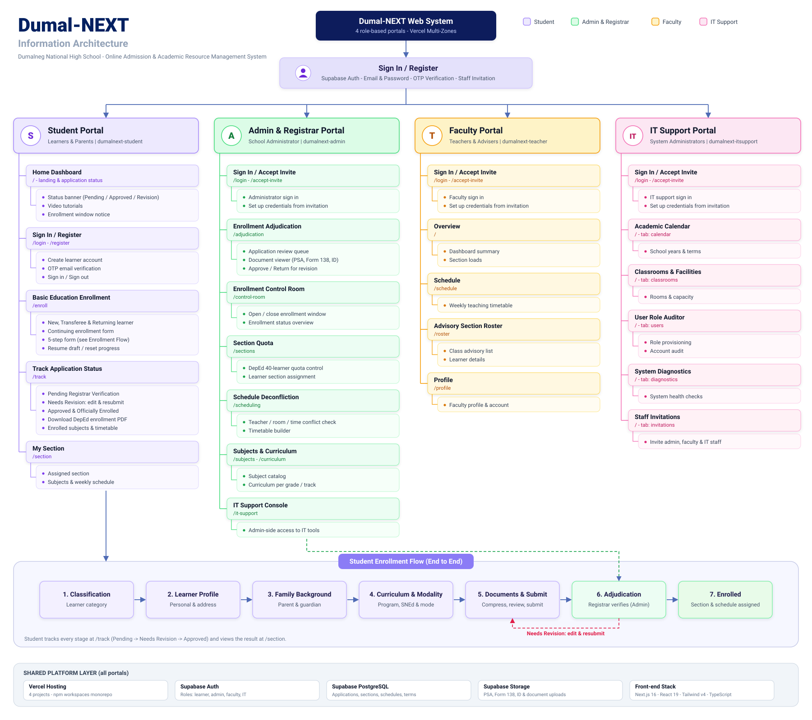

# DUMAL-NEXT: PRODUCT REQUIREMENTS DOCUMENT (PRD)

**Project Name**: Dumal-NEXT: Basic Education Online Admission & Academic Resource Management System  
**Institution**: Dumalneg National High School (DepEd School ID: 300017)  
**Division / Region**: Schools Division of Ilocos Norte, Region I  
**Proponents**: Lozano, Digap, Julian, Magdaong, Tumpap  
**Academic Affiliate**: Mariano Marcos State University (MMSU) – CCIS, Department of Information Technology  
**Document Version**: 1.0 (Production Release)  

---

## 1. Executive Summary

Dumalneg National High School is located in the Municipality of Dumalneg, Province of Ilocos Norte, serving diverse student populations across remote barangays (Cabaritan, Kalabakan, Quibel, and San Isidro) including Indigenous Peoples (Isnag) and beneficiaries of the Pantawid Pamilyang Pilipino Program (4Ps). 

**Dumal-NEXT** is a web-based, role-segregated academic management and online admission platform designed to modernize the basic education enrollment workflow. The system eliminates geographic and financial barriers for students and parents while giving school registrars, teachers, and IT administrators automated tools for section quota management, schedule deconfliction, and DepEd-compliant documentation.

---

## 2. Target Users & User Personas

| Actor / Persona | Role Description | Key Motivations & Responsibilities |
| :--- | :--- | :--- |
| **Learner & Parent** (`student`) | Incoming Grade 7, Grade 11 (SHS), Transferees, and Returning Learners | Submit enrollment applications remotely, upload PSA/Form 138 documents under low-bandwidth connections, track registrar review status in real time, and download official enrollment PDFs. |
| **Teacher / Faculty** (`teacher`) | Academic Teachers and Class Advisers | View assigned teaching schedules, check classroom room allocations, manage class advisory rosters, and access verified student profiles. |
| **Registrar / Administrator** (`admin`) | School Principal and Head Registrar | Adjudicate applications (Approve / Return for Revision), enforce the DepEd 40-learner class quota, run automated schedule deconfliction, and control the enrollment intake window. |
| **IT Support Staff** (`it_support`) | System and Network Administrators | Manage dynamic academic calendar terms (zero hardcoded dates), audit user roles, dispatch staff invitations, configure classroom facilities, and monitor system diagnostics. |

---

## 3. System Architecture & Portal Mapping

The high-level structure and functional boundary of each portal are depicted in the system Information Architecture diagram below:

---

## 4. Feature-by-Feature Specification

### 3.1. Student Online Portal (`@dumalnext/student`)

#### F-STU-01: Student Authentication & Security Code (OTP) Verification
* **Objective**: Secure student identification and ensure verified contact points.
* **Capabilities**:
  * Registration requires Full Legal Name (Last Name, First Name, Middle Name) matching PSA Birth Certificate and an active Gmail address.
  * Dispatches an official 6-digit confirmation code via Supabase Auth.
  * Real-time countdown timer (60 seconds cooldown) for resending verification codes.
  * Modal OTP dialog using separated numeric cells with automated focus progression.
  * Session recovery allowing students to pause and resume drafted applications.

#### F-STU-02: Guided 5-Step Basic Education Enrollment Stepper
* **Step 1: Classification & Academic Background**:
  * Learner categorization: New (Grade 7 / Grade 11), Transferee, Returning Learner.
  * Prior elementary / junior high school records (Last School Attended, School ID, School Year Completed, General Average).
* **Step 2: Learner Profile & DepEd Demographics**:
  * 12-digit Learner Reference Number (LRN), PSA Certificate number, Date of Birth with automatic age calculator.
  * Indigenous Peoples (IP) Community identification (Isnag community affiliation).
  * 4Ps Household Beneficiary ID validation.
  * Residential addresses (Current vs. Permanent address synchronization).
* **Step 3: Family & Guardian Background**:
  * Father, Mother (Maiden Name), and Legal Guardian contact information.
  * Primary Emergency Contact selection.
* **Step 4: Curriculum, Modality, & Special Needs (SNEd)**:
  * Junior High School (JHS): Regular Curriculum vs. Special Program in Sports (SPS).
  * Senior High School (SHS): Academic Track vs. Technical-Vocational-Livelihood (TVL) Track, Strand selection (STEM, HUMSS, TVL, etc.), and specialized trimester electives.
  * Special Needs Education (SNEd) manifestation and diagnosis tracking, including PWD ID card status.
  * Learning modality preferences (Modular Print, Blended Learning, Face-to-Face).
* **Step 5: Document Uploads & Data Privacy Agreement**:
  * Client-side HTML5 Canvas document compressor (reduces scans/photos to <1MB before transmission).
  * Upload slots: PSA Birth Certificate, Form 138 / SF9 Report Card, 2x2 ID Picture, Good Moral Certificate, 4Ps Household ID.
  * Explicit acceptance of Republic Act No. 10173 (Data Privacy Act of 2012).

#### F-STU-03: 1-Click Continuing Student Re-Enrollment
* **Objective**: Streamlined re-enrollment for existing DNHS learners advancing terms.
* **Capabilities**:
  * Automatically retrieves previous approved academic records and credentials.
  * For Junior High School (Grades 8–10), core curriculum is pre-populated without requiring elective re-entry.
  * Instant re-enrollment submission linking the student directly to their assigned continuing section.

#### F-STU-04: Real-Time Application Tracking (`/track`)
* **Objective**: Transparent visibility into the admissions pipeline without physical campus visits.
* **Capabilities**:
  * Real-time colored status badges:
    * `[ PENDING ]`: Queued for Registrar evaluation.
    * `[ NEEDS REVISION ]`: Unlocks the form so the student can update specific fields or replace blurred documents per Registrar notes.
    * `[ APPROVED ]`: Official acceptance into the school roster.
  * Displays assigned section, grade level, strand, and enrolled subject timetable.
  * Instant client-side download of the official 2-Page DepEd Basic Education Enrollment Form PDF.

#### F-STU-05: Class Section & Timetable View (`/section`)
* **Objective**: Comprehensive view of assigned class schedule and subject teachers.
* **Capabilities**:
  * Displays section name, classroom room assignment, and class adviser.
  * Weekly timetable breakdown (subject, day, time, faculty in charge).

---

### 3.2. School Administrator & Registrar Portal (`@dumalnext/admin`)

#### F-ADM-01: Enrollment Adjudication Console (`/adjudication`)
* **Objective**: Centralized review queue for processing learner admission submissions.
* **Capabilities**:
  * Filterable queue by Grade Level, Curriculum / Track, Status (Pending, Needs Revision, Approved), and School Year.
  * Built-in multi-document preview modal (in-browser inspection of PSA, Form 138, and ID pictures).
  * "Approve" action: Prompts official section assignment, assigns official LIS record status, and generates DepEd enrollment documents.
  * "Return for Revision" action: Allows registrar to input specific instructions (e.g., "Re-upload page 2 of Form 138 clearly").

#### F-ADM-02: DepEd 40-Learner Section Quota Control (`/sections`)
* **Objective**: Enforce the standard DepEd class size cap (40 students per section).
* **Capabilities**:
  * Real-time capacity progress bars (e.g., `36 / 40 enrolled`).
  * Visual indicators when a section reaches capacity warning (>= 38) and hard lock at 40.
  * Bulk section assignment and manual learner reassignment with audit logging.

#### F-ADM-03: Automated Schedule Deconfliction Engine (`/scheduling`)
* **Objective**: Eliminate scheduling conflicts across teachers, rooms, and student sections.
* **Capabilities**:
  * Conflict checking across three dimensions:
    1. **Teacher Overlap**: Prevents a teacher from being assigned to two different classes simultaneously.
    2. **Classroom Overlap**: Prevents room double-booking for the same timeslot.
    3. **Section Overlap**: Prevents a student section from having overlapping classes.
  * Visual timetable grid displaying assigned subjects and available room blocks.

#### F-ADM-04: Enrollment Control Room (`/control-room`)
* **Objective**: Administrative oversight and global intake switch.
* **Capabilities**:
  * Toggle open/closed status for online enrollment submissions.
  * Customize public advisory notices shown to students when enrollment is closed.
  * High-level statistical summaries: total applications, approval rates, strand distributions, and barangay breakdown.

#### F-ADM-05: Curriculum & Subject Catalog (`/subjects`, `/curriculum`)
* **Objective**: Manage academic offerings per grade level and track.
* **Capabilities**:
  * Catalog of JHS core subjects and SHS applied/specialized subjects.
  * Enforces the Senior High School policy limit of maximum 5 Core Subjects per trimester.

---

### 3.3. Faculty & Teacher Portal (`@dumalnext/teacher`)

#### F-TCH-01: Teaching Load & Weekly Schedule (`/schedule`)
* **Objective**: View assigned teaching schedule across Junior and Senior High School.
* **Capabilities**:
  * Comprehensive timetable showing subject title, section, assigned classroom, and time slot.
  * Cross-level load visibility (teachers handling both JHS and SHS subjects).

#### F-TCH-02: Advisory Section Roster (`/roster`)
* **Objective**: Class management for section advisers.
* **Capabilities**:
  * Alphabetical learner roster sorted by Gender (Male first, then Female) in compliance with DepEd School Form 1 (SF1).
  * Quick access to student LRN, emergency contacts, parent names, and 4Ps status.
  * Printable class list export.

#### F-TCH-03: Faculty Profile & Credential Management (`/profile`)
* **Objective**: Manage faculty contact records and account security credentials.

---

### 3.4. IT Support & System Portal (`@dumalnext/it-support`)

#### F-ITS-01: Dynamic Academic Calendar Manager
* **Objective**: Zero hardcoded dates; flexible term configuration.
* **Capabilities**:
  * Configure School Years (e.g., 2026–2027) and Trimester / Semester terms.
  * Set active term flags that propagate instantly across student intake and scheduling.
  * Define enrollment opening and closing deadlines.

#### F-ITS-02: Classroom & Facility Management
* **Objective**: Digital twin of campus physical spaces.
* **Capabilities**:
  * Register building names, room numbers, and learner seating capacity.
  * Track facility status (Active, Under Maintenance).

#### F-ITS-03: User Role Provisioning & Security Audit
* **Objective**: Role-Based Access Control (RBAC) governance.
* **Capabilities**:
  * Manage user accounts across all 4 system roles (`student`, `teacher`, `admin`, `it_support`).
  * Lock, deactivate, or reset account credentials.
  * Audit logs tracking administrative actions, approvals, and system state modifications.

#### F-ITS-04: Staff Invitation Dispatcher
* **Objective**: Secure onboarding of faculty and administrative staff.
* **Capabilities**:
  * Dispatch single-use, time-delimited invitation tokens to official staff email addresses.
  * Dedicated onboarding workflow (`/accept-invite`) allowing staff to establish secure credentials.

#### F-ITS-05: System Diagnostics & Health Monitor
* **Objective**: Proactive observability of cloud services.
* **Capabilities**:
  * Real-time latency checks for Supabase Database, Auth Services, and Storage Buckets.
  * Error rate tracking and API health statistics.

---

## 4. Non-Functional Requirements (NFR)

1. **Performance & Low-Bandwidth Resilience**:
   * Initial page payload must load in < 2.5 seconds on 3G connections.
   * Client-side image compression must compress multi-megabyte document camera photos down to < 1 MB before network transmission.
2. **Reliability & Availability**:
   * Target 99.9% uptime hosted on Vercel Edge Network with Supabase PostgreSQL replication.
3. **Security & Data Privacy**:
   * Compliance with Republic Act No. 10173 (Philippine Data Privacy Act).
   * Row-Level Security (RLS) enforced at the PostgreSQL database kernel level.
   * Passwords hashed using bcrypt/Argon2 via Supabase Auth; session cookies transmitted with `HttpOnly`, `SameSite=Lax`, and `Secure` attributes.
4. **Usability & Accessibility**:
   * Compliant with DepEd institutional design system: Navy Blue (`#002060`) and White (`#FFFFFF`).
   * Mobile-responsive interface supporting touch targets of at least 42px on mobile and tablet devices.
   * Zero decorative emojis in compliance with academic administrative standards.
