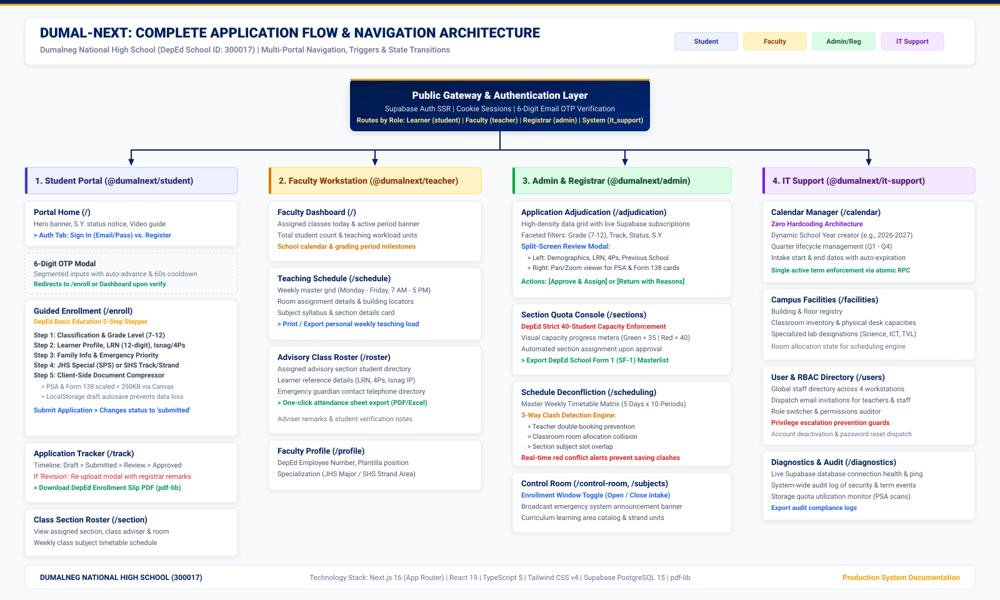

# DUMAL-NEXT: APPLICATION FLOW DOCUMENT (AFD)

**Scope**: Page-by-Page Navigation, User Interaction Triggers, and State Transitions  
**Applications Covered**: Student Portal, Teacher Workstation, Admin Console, and IT Support System  
**Document Version**: 1.0 (Production Release)  

---

## 1. High-Level System Flow Diagram

The following high-resolution diagram illustrates the navigation architecture, role-based branches, and page-by-page state transitions across all four workstations.

---

## 2. Student Portal Workflow (`@dumalnext/student`)

### Page 1: Portal Landing & Authentication (`/`)

* **Initial State**:
  * Desktop split-screen view: Left side displays Dumalneg NHS Hero Banner, S.Y. Status Badge, and 4-Step Roadmap. Right side displays the Sticky Authentication Card.
  * Mobile view: Hero and Authentication Card stack seamlessly with touch-friendly controls.
* **User Actions & Transitions**:
  1. **Click "Sign In" Tab**:
     * Activates email and password inputs.
     * User enters email and password $\rightarrow$ Clicks **"Sign In to Student Portal"**.
     * Visual Progress Bar increments from 0% $\rightarrow$ 55% $\rightarrow$ 90% $\rightarrow$ 100%.
     * **Success**: Redirects to the **Authenticated Student Dashboard** (`/`).
     * **Error (Invalid credentials)**: Inline alert displays "Authentication Error: Invalid email or password".
     * **Error (Unverified email)**: Displays "6-Digit Email Verification Required" banner with **"Enter 6-Digit Code"** button.
  2. **Click "Create Account" Tab**:
     * Activates registration fields: Last Name, First Name, Middle Name, Gmail Address, Password, Confirm Password.
     * User submits form $\rightarrow$ Clicks **"Create Student Account"**.
     * **Success**: Clears form, dispatches 6-digit confirmation code, and automatically triggers the **6-Digit OTP Verification Modal**.
  3. **OTP Verification Modal**:
     * Displays target email address with 6 separated numeric input cells.
     * Auto-advances focus upon each digit typed.
     * Clicking **"Verify & Activate Account"**: Validates code with Supabase Auth $\rightarrow$ Closes modal $\rightarrow$ Immediately redirects to **Online Enrollment** (`/enroll`).
     * Clicking **"Resend Code"**: 60-second cooldown timer prevents spam; dispatches new code.

---

### Page 2: Guided Online Enrollment (`/enroll`)

* **Initial Route Guard**:
  * If unauthenticated: Redirects to `/?tab=signin&notice=auth_required`.
  * If enrollment is closed by Administrator: Displays the official closed notice configured in the Control Room.
  * If user is a **Continuing Learner** with approved past records: Presents the **1-Click Continuing Enrollment Card** with pre-filled academic history.

* **5-Step Enrollment Stepper Flow**:
  1. **Step 1: Classification & Background**:
     * Selects: Applicant Type (`New`, `Transferee`, `Returning Learner`), Target Grade Level (7 to 12).
     * Enters: Last Grade Level Completed, School Year Completed, Previous School Name, and Previous School ID.
     * Click **"Proceed to Step 2: Learner Profile"** $\rightarrow$ Saves Step 1 draft to local storage and advances stepper.
  2. **Step 2: Learner Profile & Demographics**:
     * Enters: 12-digit DepEd LRN, PSA Birth Certificate Number, Date of Birth (interactive date picker auto-calculates age), Gender, Mother Tongue, and Religion.
     * Toggles: Indigenous Peoples (IP) identification (Isnag community name input).
     * Toggles: 4Ps Beneficiary status (16-digit Household ID input).
     * Enters: Current Address (House No, Sitio, Barangay, Municipality, Province, Zip).
     * Checkbox: "Permanent Address is same as Current Address" (auto-copies fields if checked).
     * Click **"Proceed to Step 3: Family Background"** $\rightarrow$ Validates mandatory fields and advances.
  3. **Step 3: Family & Guardian Background**:
     * Enters: Father's full name and contact number.
     * Enters: Mother's maiden name (First, Middle, Maiden Last Name) and contact number.
     * Optional: Legal Guardian name and contact details.
     * Selects: Primary Emergency Contact Person (`Father`, `Mother`, `Guardian`).
     * Click **"Proceed to Step 4: Curriculum & Modality"** $\rightarrow$ Advances.
  4. **Step 4: Curriculum, Modality, & Special Needs (SNEd)**:
     * If Grade 7–10 (JHS): Choose between `Regular JHS Curriculum` or `Special Program in Sports (SPS)`.
     * If Grade 11–12 (SHS): Choose `Academic Track` vs. `TVL Track`, select Strand (`STEM`, `HUMSS`, `TVL`, etc.), and select authorized Trimester Electives.
     * SNEd Section: Toggles Special Needs Education category (`Diagnosis` vs `Manifestations`), checklist of accommodations, and PWD ID status.
     * Preferred Modality: Checkboxes for `Modular (Print)`, `Blended Learning`, `Face-to-Face`.
     * Click **"Proceed to Step 5: Documents & Review"** $\rightarrow$ Advances.
  5. **Step 5: Document Uploads & Final Submission**:
     * Upload slots: PSA Birth Certificate, SF9 / Form 138 Report Card, 2x2 ID Picture, Good Moral Certificate.
     * Drag-and-drop or file selector activates the **Canvas Image Compressor**, compressing files to <1MB.
     * Thumbnail previews allow user to confirm image clarity.
     * Checkbox: "I have reviewed all information and agree to the DepEd Data Privacy terms."
     * Click **"Submit Official Enrollment Application"**:
       * Uploads compressed files to Supabase Storage bucket `enrollment-documents`.
       * Inserts application record into `enrollment_applications`.
       * Dispatches instant event `dumalnext:data-changed`.
       * Redirects to **Application Tracker** (`/track?ref=APP-XXXXX`).

---

### Page 3: Real-Time Application Tracker (`/track`)

* **Query Parameter Handling**:
  * URL query `?ref=APP-XXXXX` automatically selects and highlights the specified application.
* **Status Views**:
  * **Status: `Pending`**:
    * Displays "Status: Pending Registrar Verification" in amber badge.
    * Summary of submitted demographic data, uploaded documents, and submission date.
  * **Status: `Needs Revision`**:
    * Red alert card displays **Registrar Feedback Remarks** (e.g., "PSA copy is unreadable; please re-upload").
    * Action button: **"Edit & Resubmit Application"** $\rightarrow$ Redirects to `/enroll` with all steps unlocked and pre-filled with existing data for quick correction.
  * **Status: `Approved`**:
    * Green emerald badge: "Approved & Officially Enrolled".
    * Unlocks the button: **"Download Official DepEd Form (PDF)"** $\rightarrow$ Triggers client-side PDF generation and direct browser download.
    * Unlocks the tab: **"View Enrolled Subjects & Timetable"** $\rightarrow$ Scrolls to assigned timetable grid.

---

### Page 4: Class Section & Timetable View (`/section`)

* **State Handling**:
  * If student has not yet enrolled: Displays "Enrollment Required" prompt with a direct button to `/enroll`.
  * If student is approved: Displays Section Name, Grade Level, Strand, Class Adviser, Room Number, and full weekly schedule.

---

## 3. Administrator & Registrar Workflow (`@dumalnext/admin`)

### Page 1: Administrator Authentication (`/login`)
* Inputs: Admin Email and Password.
* Post-login: Authenticates against `school_administrators` table and redirects to **Adjudication Console** (`/adjudication`).

### Page 2: Enrollment Adjudication Console (`/adjudication`)
* **Queue View**:
  * Displays real-time list of all incoming enrollment applications with search filters (by Name, LRN, Grade Level, Status).
* **Clicking an Applicant Row**:
  * Triggers the **Adjudication Modal**:
    * Side-by-side view: Full student demographic form on left; in-browser Document Viewer on right (zoom, rotate, and full-resolution inspection of PSA, Form 138, and ID pictures).
    * Action A (**Approve**): Opens section assignment selector (showing remaining capacity for each section) $\rightarrow$ Commits approval to database $\rightarrow$ Updates student status to `Approved`.
    * Action B (**Needs Revision**): Opens text area for Registrar Feedback $\rightarrow$ Enters reasons $\rightarrow$ Updates status to `Needs Revision` $\rightarrow$ Triggers student notification.

### Page 3: Section Quota Management (`/sections`)
* Lists all sections for the active school year grouped by Grade Level.
* Capacity meters display current enrollment count against the 40-learner DepEd quota.
* Clicking **"Manage Section"**: Allows manual learner reassignment, balancing section sizes.

### Page 4: Schedule Deconfliction Console (`/scheduling`)
* Visual grid displaying days of the week (Monday–Friday) and hourly timeslots (7:00 AM – 5:00 PM).
* Clicking an empty timeslot allows the administrator to assign: Subject, Teacher, Section, and Classroom.
* Submitting the slot executes the **Deconfliction Engine**:
  * If conflict detected: Modal alert highlights the collision (e.g., "Teacher Mr. Lozano is already assigned to Section 7-Rizal in Room 101 at 9:00 AM").
  * If clean: Persists slot to `schedule_slots` table.

### Page 5: Enrollment Control Room (`/control-room`)
* Global master switch: **"Online Enrollment Intake [ OPEN / CLOSED ]"**.
* Text field to edit custom public message when closed.
* Live metric tiles: Total applicants, approved count, pending review, quota capacity percentages.

---

## 4. Faculty & Teacher Workflow (`@dumalnext/teacher`)

### Page 1: Teacher Dashboard (`/`)
* Summary of active academic term and total assigned student load count.

### Page 2: Weekly Teaching Timetable (`/schedule`)
* Displays personal teaching calendar categorized by day and time block.
* Highlights room facility assignment for each class.

### Page 3: Advisory Section Roster (`/roster`)
* Dropdown to select assigned advisory section.
* Generates official class roster formatted to DepEd School Form 1 (SF1) standards:
  * Male learners listed first in alphabetical order.
  * Female learners listed second in alphabetical order.
  * Displays Student LRN, full name, birth date, age, IP status, 4Ps status, and emergency contact numbers.
* Print / Export action for generating hardcopy class lists for attendance and grading sheets.

---

## 5. IT Support & Systems Workflow (`@dumalnext/it-support`)

### Workstation Hub (`/` with tab navigation):

1. **Tab 1: Academic Calendar (`activeTab=calendar`)**:
   * View all configured academic terms.
   * Button **"Add School Year / Term"**: Prompts School Year (e.g., 2026-2027), Term Name (Trimester 1, 2, 3), Start Date, End Date.
   * Action **"Set as Active Term"**: Automatically transitions active status across all 4 portals.
2. **Tab 2: Classrooms & Facilities (`activeTab=classrooms`)**:
   * Register campus buildings and room numbers.
   * Edit maximum student capacity per classroom.
3. **Tab 3: User Role Auditor (`activeTab=users`)**:
   * Displays all user records with search and role filters (`student`, `teacher`, `admin`, `it_support`).
   * Ability to lock accounts or trigger password reset workflows.
4. **Tab 4: Staff Invitations (`activeTab=invitations`)**:
   * Form: Staff Email, Full Name, Assigned Role (`teacher`, `admin`, `it_support`).
   * Clicking **"Send Invitation"**: Generates cryptographic token and sends onboarding email link.
5. **Tab 5: System Diagnostics (`activeTab=diagnostics`)**:
   * Real-time ping latency to Supabase PostgreSQL database and Storage APIs.
   * Memory usage and cloud service operational statuses.
