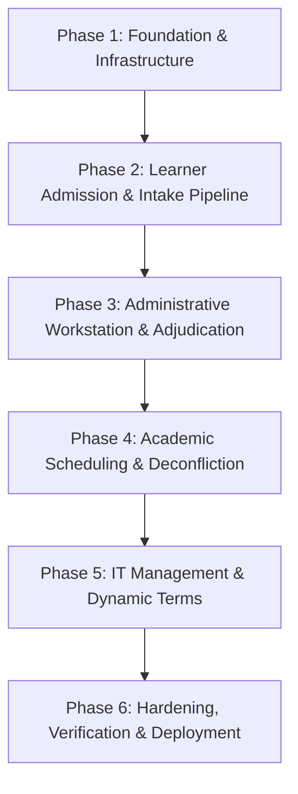
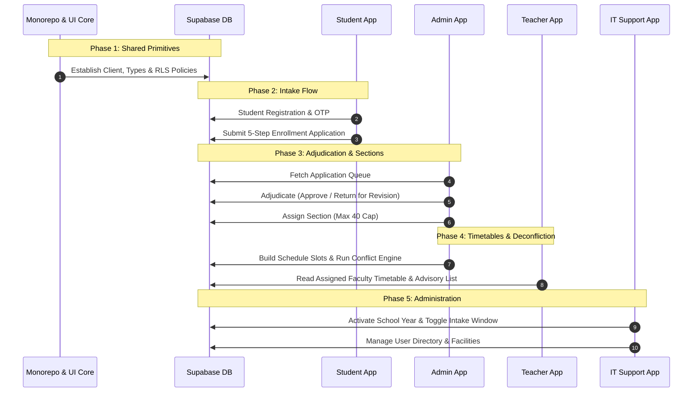

# DUMAL-NEXT: IMPLEMENTATION PLAN DOCUMENT (IPD)

**Project Name**: Dumal-NEXT: Basic Education Online Admission & Academic Resource Management System  
**Institution**: Dumalneg National High School (DepEd School ID: 300017)  
**Division / Region**: Schools Division of Ilocos Norte, Region I  
**Proponents**: Lozano, Digap, Julian, Magdaong, Tumpap  
**Academic Affiliate**: Mariano Marcos State University (MMSU) – CCIS, Department of Information Technology  
**Document Version**: 1.0 (Production Release)  

---

## 1. Executive Summary & Implementation Strategy

The **Dumal-NEXT Implementation Plan** provides an exhaustive, milestone-driven technical roadmap detailing the sequence, architectural dependencies, and delivery stages for the Dumalneg National High School academic portal. 

Adhering strictly to modern agile engineering principles, the system is engineered in a decoupled monorepo architecture using **Next.js 16 (App Router)**, **React 19**, **TypeScript 5**, **Tailwind CSS v4**, and **Supabase (PostgreSQL 15 with Row-Level Security)**. 

### Core Constraints & Guiding Principles
1. **Frontend-First Execution**: The database schema and Supabase backend architecture remain locked as the single source of truth; all development focuses on client-side state handling, UI ergonomics, validation logic, and performance under rural bandwidth constraints.
2. **DepEd Institutional Rigor**: Every module strictly satisfies Department of Education (DepEd) standards, including DepEd Order No. 03, s. 2018 (Basic Education Enrollment Policy), the mandatory 40-learner section quota, and standard institutional color tokens (Navy Blue `#002060`, Pure White `#FFFFFF`, Gold/Amber `#F59E0B`).
3. **Bandwidth Optimization for Dumalneg**: Because learners and parents in remote barangays (Cabaritan, Kalabakan, Quibel, San Isidro) frequently access the platform via intermittent 3G/LTE cellular connections, all image compression and document compilation are executed on the client hardware before transmission.

---

## 2. Phased Implementation Roadmap

The implementation is structured across **six (6) sequential phases**, spanning sixteen (16) targeted sprints.

---

### Phase 1: Foundation, Infrastructure & Design System Setup

* **Objective**: Establish the multi-zone monorepo workspace, base configuration, shared component primitives, and validated database connectivity.
* **Duration**: 2 Sprints (Sprint 1.1 - 1.2)
* **Dependencies**: Supabase project provisioning, Git repository initialization.

#### Sprint 1.1: Monorepo Architecture & Multi-Zone Configuration
* **Deliverables**:
  1. Initialize npm workspaces / Turborepo monorepo with 4 isolated applications:
     * `apps/student` (`@dumalnext/student`, Port 3000)
     * `apps/teacher` (`@dumalnext/teacher`, Port 3001)
     * `apps/admin` (`@dumalnext/admin`, Port 3002)
     * `apps/it-support` (`@dumalnext/it-support`, Port 3003)
  2. Configure shared packages:
     * `packages/ui`: Shared Tailwind CSS v4 design tokens, atomic UI components, icons (`lucide-react`).
     * `packages/shared`: Shared TypeScript types, Zod schemas, date formatters, and DepEd curriculum constants.
  3. Setup Vercel Multi-Zones routing configuration in root `next.config.ts`.
  4. Configure strict TypeScript (`strict: true`, `noImplicitAny: true`) and ESLint rules across all workspaces.

#### Sprint 1.2: DepEd Design System & Atomic UI Component Library
* **Deliverables**:
  1. Implement Tailwind CSS v4 design tokens:
     * Primary Navy (`#002060`), Secondary Blue (`#003399`), Accent Amber (`#F59E0B`), Surface Canvas (`#F8FAFC`).
     * Explicit zero-emoji policy; strictly utilize stroke-based SVG icons from Lucide.
     * Uniform corner radius token (`rounded-md` / 4px-6px) for formal institutional look.
  2. Build atomic UI primitives in `packages/ui`:
     * Buttons: `Primary`, `Secondary`, `Outline`, `Destructive`, `Ghost` with loading state spinners.
     * Inputs: Text inputs, Select menus, Date pickers, Checkbox, Radio groups with inline error states.
     * Feedback: Modal dialogs, Slide-over drawers, Toast notifications, Progress bars, Skeleton loaders.
     * Data Display: Badge status pills, Metric stat cards, Section header banners.

---

### Phase 2: Learner Admission & Intake Pipeline (`@dumalnext/student`)

* **Objective**: Build the public-facing and authenticated learner enrollment experience, client-side document processing, real-time status tracking, and offline-capable PDF generator.
* **Duration**: 3 Sprints (Sprint 2.1 - 2.3)
* **Dependencies**: Phase 1 design system and Supabase Auth.

#### Sprint 2.1: Authentication & OTP Verification Flow
* **Deliverables**:
  1. Build Student Sign-Up and Sign-In views with email and password.
  2. Implement Supabase Email OTP verification modal:
     * 6-box segmented numeric input with auto-advance and backspace navigation.
     * 60-second cooldown timer for code resend.
     * Error handling for expired or invalid OTP tokens.
  3. Create session-recovery middleware redirecting authenticated learners to their application status.

#### Sprint 2.2: Guided 5-Step Basic Education Enrollment Stepper
* **Deliverables**:
  1. Build multi-step enrollment form state machine with local storage draft persistence:
     * **Step 1 (Classification)**: Grade Level selection (Grade 7 to 12), Learner Category (New, Transferee, Returning), Prior School ID and average.
     * **Step 2 (Learner Profile)**: 12-digit LRN validation, PSA Birth Certificate Number, Indigenous Peoples (Isnag) selection, 4Ps Beneficiary ID, Address fields.
     * **Step 3 (Family Background)**: Father, Mother (Maiden), Legal Guardian records, and Emergency Contact priority.
     * **Step 4 (Academic Program)**: JHS Regular Basic Education; SHS Track (Academic / TVL) and Strand (STEM, HUMSS, TVL-ICT, etc.); Learning modality preference.
     * **Step 5 (Documents & Declaration)**: Document file uploader, DepEd data privacy consent, and electronic sign-off.
  2. Implement client-side validation using Zod with bilingual English/Filipino field messages.

#### Sprint 2.3: In-Browser Document Compression & Enrollment Slip PDF Engine
* **Deliverables**:
  1. Build client-side HTML5 Canvas document compressor:
     * Intercept PSA Birth Certificate, Form 138 (Report Card), and Good Moral Certificate uploads.
     * Dynamically downscale image dimensions to maximum 1600px width/height.
     * Compress to JPEG at 0.72 quality, reducing 5MB-10MB mobile camera photos to < 350KB.
     * Render instant thumbnail preview with pinch-to-zoom and replace capabilities.
  2. Integrate `pdf-lib` for client-side DepEd Enrollment Certificate generation:
     * Build template rendering DepEd Republic of the Philippines seal and Dumalneg NHS header.
     * Populate learner demographics, reference number, grade level, and registrar verification status.
     * Downloadable directly on mobile devices without server round-trip.
  3. Build Learner Status Dashboard displaying application timeline:
     * `draft` -> `submitted` -> `under_review` -> `approved` / `resubmission_required`.
     * Revision Banner detailing specific registrar feedback and document re-upload buttons.

---

### Phase 3: Administrative Workstation & Application Adjudication (`@dumalnext/admin`)

* **Objective**: Deliver the high-density registrar and principal interface for reviewing enrollment submissions, managing section capacity, and exporting DepEd reports.
* **Duration**: 3 Sprints (Sprint 3.1 - 3.3)
* **Dependencies**: Phase 2 database entries.

#### Sprint 3.1: Admin Shell & Real-Time Intake Dashboard
* **Deliverables**:
  1. Implement secure role-protected layout verifying `admin` role via custom claims / metadata.
  2. Create executive KPI metrics banner:
     * Total Applications, Pending Verification, Approved Learners, Returned for Revision.
     * Section Enrollment Capacity gauge (Overall vs. Grade-level).
  3. Implement Enrollment Intake Window control switch (Open/Close intake globally with real-time banner update).

#### Sprint 3.2: High-Density Application Data Grid & Faceted Search
* **Deliverables**:
  1. Build responsive data table with virtualized scrolling for high-volume record sets:
     * Columns: Reference No, LRN, Full Name, Grade Level, Strand/Program, Submission Date, Review Status.
  2. Implement debounced instant search (querying Name, LRN, and Reference Number).
  3. Multi-faceted filters: Filter by Grade Level (7-12), Status (`submitted`, `under_review`, `approved`, `resubmission_required`), Curriculum Track, and Academic Term.
  4. Batch actions: Bulk status update, Bulk CSV export.

#### Sprint 3.3: Adjudication Review Modal & Section Quota Manager
* **Deliverables**:
  1. Build split-screen Document Adjudication Modal:
     * Left pane: Learner biographical data, 4Ps status, prior school credentials.
     * Right pane: Pan-and-zoom document viewer for PSA certificate and Form 138 cards.
  2. Adjudication action controls:
     * **Approve**: Assigns student to approved state and triggers section assignment selector.
     * **Return for Revision**: Interactive checklist of deficiency reasons (e.g., "PSA blurred", "LRN discrepancy", "Missing signature") with custom registrar remark textarea.
  3. Build Section Capacity Manager:
     * Enforce strict DepEd maximum cap of **40 learners per section**.
     * Visual occupancy bar (Green: < 35, Amber: 35-39, Red: 40 [Locked]).
     * Automatic prevention of over-enrollment.
  4. DepEd Master List Generator: Export official Class Rosters formatted to DepEd School Form 1 (SF-1) specification.

---

### Phase 4: Academic Scheduling & Deconfliction Engine (`@dumalnext/admin` & `@dumalnext/teacher`)

* **Objective**: Build the master schedule builder, automated clash-detection algorithm, and the teacher/faculty timetable portal.
* **Duration**: 3 Sprints (Sprint 4.1 - 4.3)
* **Dependencies**: Phase 3 section setup and teacher profiles.

#### Sprint 4.1: Master Schedule Builder & Timetable Matrix
* **Deliverables**:
  1. Build two-dimensional scheduling matrix (Days: Monday to Friday x Time Slots: 7:00 AM - 5:00 PM in 60-minute blocks).
  2. Support schedule slot creation modal:
     * Select Section, Subject/Learning Area, Teacher, Room, Day of Week, Start Time, End Time.
  3. Color-code schedule blocks by subject category (Core Academics, Applied/Specialized, MAPEH/TLE).

#### Sprint 4.2: Automated Schedule Deconfliction Engine
* **Deliverables**:
  1. Implement deterministic client-side overlap detection algorithm:
     $$\text{Conflict} = (A_{\text{day}} = B_{\text{day}}) \land (A_{\text{start}} < B_{\text{end}}) \land (A_{\text{end}} > B_{\text{start}})$$
  2. Check for three distinct conflict dimensions:
     * **Teacher Clash**: Instructor assigned to two distinct classes simultaneously.
     * **Room Clash**: Physical classroom assigned to two separate sections simultaneously.
     * **Section Clash**: A single student cohort scheduled for overlapping subjects.
  3. Interactive Clash Prevention UI:
     * Real-time warning alert displayed inside the modal before saving.
     * Conflicting grid cells highlight in Red (`#DC2626`) with popover indicating overlapping entry details.

#### Sprint 4.3: Teacher Workstation (`@dumalnext/teacher`)
* **Deliverables**:
  1. Build Teacher Dashboard displaying:
     * Weekly Personal Teaching Timetable with highlight on current/next active class.
     * Room assignments and subject credits.
  2. Build Advisory Class Section Roster:
     * List of enrolled students in teacher's advisory section.
     * Student information summary (Emergency contact, 4Ps status, LRN).
     * One-click download of advisory class attendance sheet.

---

### Phase 5: IT Support, Dynamic Terms & Facilities Management (`@dumalnext/it-support`)

* **Objective**: Provide comprehensive administration of academic terms (zero hardcoded dates), user roles, facilities, and audit logging.
* **Duration**: 2 Sprints (Sprint 5.1 - 5.2)
* **Dependencies**: Phase 1-4 database structures.

#### Sprint 5.1: Dynamic Academic Calendar & Enrollment Window Management
* **Deliverables**:
  1. Build Academic Term Manager:
     * Add, edit, and activate School Years (e.g., "2026-2027") and Quarters (Q1 to Q4).
     * Enforce single active term constraint via atomic transaction/RPC.
  2. Configure Enrollment Window Controller:
     * Set Intake Start Date and Intake End Date.
     * Global Emergency Close switch with custom announcement banner for students.

#### Sprint 5.2: User RBAC Directory & Facility Registry
* **Deliverables**:
  1. Build Staff Account Management:
     * Search and filter staff by role (`admin`, `teacher`, `it_support`).
     * Dispatch account creation invitations and trigger password resets.
     * Role update interface with privilege escalation prevention.
  2. Build Campus Facilities & Classroom Registry:
     * Register Buildings, Floor levels, Room Names, and physical seating capacities.
  3. Build System Diagnostics & Audit Trail Viewer:
     * Display recent critical events (term activations, bulk approvals, role changes).
     * Telemetry view for Supabase API latency and storage quota utilization.

---

### Phase 6: Cross-Workstation UI Polish, Quality Assurance & Production Deployment

* **Objective**: Finalize accessibility compliance, low-bandwidth validation, automated build pipelines, and production deployment on Vercel.
* **Duration**: 3 Sprints (Sprint 6.1 - 6.3)
* **Dependencies**: All preceding phases.

#### Sprint 6.1: Accessibility (a11y) & DepEd Visual Compliance Audit
* **Deliverables**:
  1. Conduct full accessibility sweep:
     * Ensure WCAG 2.1 AA color contrast across all Navy/Gold/White combinations.
     * Full keyboard navigability (`Tab`, `Shift+Tab`, `Enter`, `Escape`) across all modals, drawers, and form fields.
     * Proper ARIA labels (`aria-expanded`, `aria-controls`, `aria-describedby`) on dynamic interactive elements.
  2. Verify typography consistency: Universal system font stack (`font-sans`), standard line heights, and absence of visual clutter or emojis.

#### Sprint 6.2: Low-Bandwidth Stress Testing & Edge-Case Validation
* **Deliverables**:
  1. Validate client-side image compressor on throttled network profiles (Fast 3G: 1.6 Mbps / Slow 3G: 400 Kbps).
  2. Verify graceful degradation:
     * Informative offline/intermittent connection warning toasts.
     * Form state auto-saving to IndexedDB / LocalStorage so users never lose entered step data during mobile signal drops.
  3. Validate deconfliction engine performance on large schedule matrices (100+ slots under 50ms execution time).

#### Sprint 6.3: Production Build, Multi-Zone Routing & Vercel Deployment
* **Deliverables**:
  1. Build pipeline optimization:
     * Verify bundle sizes for all 4 sub-apps (< 180KB initial JS chunk).
     * Configure static route caching and Incremental Static Regeneration (ISR) where applicable.
  2. Setup Vercel deployment with environment variables and custom domain routing.
  3. Conduct User Acceptance Testing (UAT) sign-off with Dumalneg NHS stakeholders.

---

## 3. Work Breakdown Structure (WBS) & Deliverables Matrix

| Phase | Sprint | Work Package / Deliverable | Responsible Portal | Success Criteria |
| :--- | :--- | :--- | :--- | :--- |
| **Phase 1** | **Sprint 1.1** | Monorepo & Multi-Zone Configuration | Root Workspace | All 4 apps build cleanly in parallel via Turborepo. |
| | **Sprint 1.2** | DepEd Atomic UI Component Library | `packages/ui` | Tokens, buttons, modals, and inputs operational without emojis. |
| **Phase 2** | **Sprint 2.1** | Student Auth & 6-Digit OTP Flow | `@dumalnext/student` | Email OTP functional with 60s cooldown and numeric auto-focus. |
| | **Sprint 2.2** | 5-Step Enrollment Stepper Form | `@dumalnext/student` | Full DepEd basic ed fields validated via Zod with draft autosave. |
| | **Sprint 2.3** | Canvas Image Compressor & PDF Slip | `@dumalnext/student` | Photos compressed to <350KB; PDF certificate downloads offline. |
| **Phase 3** | **Sprint 3.1** | Admin Shell & Real-time Metrics | `@dumalnext/admin` | Protected route renders live enrollment KPIs and intake toggle. |
| | **Sprint 3.2** | High-Density Table & Faceted Filters | `@dumalnext/admin` | Filter by Grade/Status with debounced search across thousands of rows. |
| | **Sprint 3.3** | Review Modal & 40-Student Quota Cap | `@dumalnext/admin` | Split document review works; sections strictly reject 41st student. |
| **Phase 4** | **Sprint 4.1** | Master Timetable Schedule Grid | `@dumalnext/admin` | 5-day x 10-hour matrix renders interactive schedule blocks. |
| | **Sprint 4.2** | 3-Way Schedule Deconfliction Engine | `@dumalnext/admin` | Teacher, room, and section clashes flagged instantly in UI. |
| | **Sprint 4.3** | Teacher Timetable & Advisory Roster | `@dumalnext/teacher` | Faculty sees personal schedule and advisory student directory. |
| **Phase 5** | **Sprint 5.1** | Academic Terms & Enrollment Window | `@dumalnext/it-support`| Dynamic term activation with zero hardcoded academic years. |
| | **Sprint 5.2** | RBAC Directory & Facilities Registry | `@dumalnext/it-support`| Staff role management and room capacity registry operational. |
| **Phase 6** | **Sprint 6.1** | WCAG 2.1 AA & DepEd Visual Audit | All Workspaces | Contrast ratios > 4.5:1, keyboard tab-flow verified. |
| | **Sprint 6.2** | Low-Bandwidth 3G & Offline Resilience | `@dumalnext/student` | Zero lost submissions during simulated cellular disconnects. |
| | **Sprint 6.3** | Production Multi-Zone Vercel Deploy | Root Workspace | Vercel production deployment passes all health checks. |

---

## 4. Critical Path & Dependency Analysis

### Risk Assessment & Mitigation Strategy

| Risk Factor | Impact | Likelihood | Mitigation Strategy |
| :--- | :--- | :--- | :--- |
| **Rural Cellular Latency in Dumalneg** | High | High | Client-side HTML5 canvas compression (< 350KB), optimistic UI updates, and LocalStorage draft persistence. |
| **Over-Enrollment in Popular Sections** | High | Medium | Hard validation guard in section assignment component enforcing `enrolled_count < max_capacity` (40). |
| **Faculty Double-Booking Conflicts** | Medium | Medium | Automated client-side deconfliction algorithm checks $(A_{\text{start}} < B_{\text{end}} \land A_{\text{end}} > B_{\text{start}})$ before commit. |
| **Accidental Backend Changes** | Critical | Low | Strict workspace boundary; frontend consumes immutable Supabase API schema without altering backend tables or routes. |
| **Vercel Multi-Zone Routing Collisions** | Medium | Low | Distinct asset prefixes and path rewrites (`/admin`, `/teacher`, `/it-support`, `/`) cleanly decoupled in `next.config.ts`. |

---

## 5. Verification & Acceptance Criteria (Definition of Done)

Each phase is subject to formal verification before sign-off:

1. **Compilation & Type Safety**:
   * Root `npm run build` compiles all 4 Next.js applications with zero TypeScript or lint errors.
2. **Visual & Design Standard**:
   * DepEd color palette (`#002060`, `#FFFFFF`, `#F59E0B`) strictly applied.
   * Completely free of decorative emojis.
   * Universal system typography hierarchy and 4px-6px border radius maintained.
3. **Institutional Integrity**:
   * DepEd School ID `300017` displayed on all official portal headers and downloaded enrollment slips.
   * 40-student section cap strictly enforced by the system.
4. **Git Version Control**:
   * Every sprint release is committed with descriptive commit messages and pushed cleanly to the `main` branch on GitHub.
